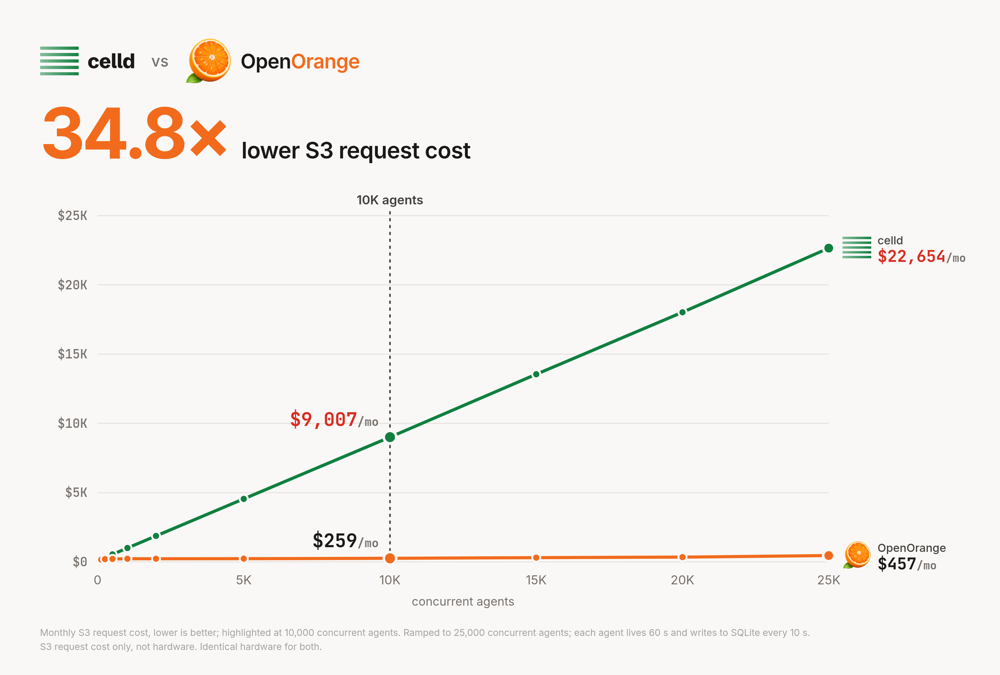
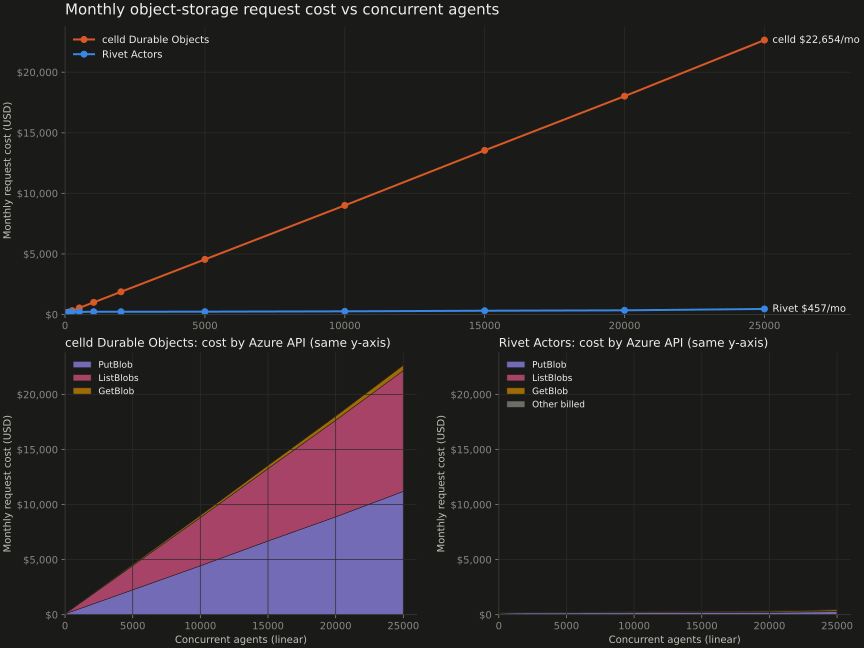

# OpenOrange vs celld: measured S3 request cost

OpenOrange is built on Rivet's storage engine. This benchmark runs actual Rivet and actual celld
on the same SQLite workload, sequentially on the same machines at each agent count, and compares
the object-store requests each one makes, priced at S3 rates, from 8 to 25,000 concurrent agents.



**34.8x lower S3 request cost at 10,000 concurrent agents: $259/month vs $9,007/month.**

- Ramped to 25,000 concurrent agents.
- Each agent lives 60 seconds and writes to SQLite every 10 seconds, then sleeps.
- Measured S3 request cost only. Hardware is not included.
- Identical hardware for both at every agent count.

## Workload

Each agent stays awake for **60 seconds**, makes one **SQLite write every
10 seconds** (±20% jitter), rotating over 16 rows, then sleeps with its data
retained. A fresh agent then takes its place, so the number of concurrent agents stays constant.
Rivet explicitly sleeps retired actors; celld closes their WebSockets and uses a
one-second idle eviction timeout with default fleet durability.

After adding a cohort, settle for two minutes, then measure **five complete UTC
minutes** at that population. Every reported hold checks actual connected agents,
completed one-minute lifetimes, acknowledged writes and zero client errors.
Temporary WebSocket 1012 responses before connection get up to five counted
retries; those requests remain in the cost totals. Writes are not retried by the
benchmark driver.

## Results

[Open the report](report/scale-25k-20261108/index.html) ·
[Request counts by API](report/scale-25k-20261108/requests.csv) ·
[Minute samples](report/scale-25k-20261108/minutes.csv) ·
[Recorded lifetimes](report/scale-25k-20261108/lifetimes.csv) ·
[Raw results](results/)

| Concurrent agents | Nodes per platform | Rivet requests / month | celld requests / month |
| ---: | ---: | ---: | ---: |
| 8 | 6 | $74.64 | $64.32 |
| 16 | 6 | $85.02 | $80.93 |
| 32 | 6 | $105.26 | $105.09 |
| 64 | 6 | $135.63 | $141.82 |
| 128 | 6 | $161.93 | $200.17 |
| 256 | 6 | $196.83 | $314.55 |
| 512 | 6 | $212.89 | $543.27 |
| 1,024 | 6 | $227.05 | $1,000.61 |
| 2,000 | 6 | $225.81 | $1,872.28 |
| 5,000 | 6 | $231.80 | $4,547.44 |
| 10,000 | 6 | $259.18 | $9,006.65 |
| 15,000 | 12 | $308.88 | $13,547.52 |
| 20,000 | 12 | $342.73 | $18,024.79 |
| 25,000 | 24 | $457.14 | $22,653.80 |

These are **actual Azure Blob requests repriced at S3 rates**, projected for 730
hours: GET/HEAD $0.0004 per 1,000, PUT/LIST $0.005 per 1,000, deletes free.
The report separately prices inventoried stored bytes at **$18.40 per decimal
TB-month**. That storage column prices the observed size if held for a month;
it does not assume a month of future data growth. Compute, memory and egress
charges are outside this comparison.



## Hardware

Six nodes through 10,000 agents; twelve at 15,000 and 20,000; twenty-four at
25,000. Both platforms use the same machines at each level, in eastus2 zone 1.
Every node has 16 vCPUs, 64 GB RAM and the same AMD EPYC 9V45 CPU model, plus a
1 TiB Premium SSD v2 data disk configured for 20,000 IOPS / 900 MB/s.

The first twelve nodes are D16as_v7; the twelve added for the final sample are
D16ads_v7 with matching CPU, RAM and external-disk limits. Their local temporary
disks are unused. Two separate D8as_v7 VMs generate load. Each platform has its
own Standard LRS Azure Blob account.

Rivet keeps three replicas of every write, spread evenly across the nodes at
every level. Versions and binaries are pinned in
`versions.json`, `versions.sha256.json` and `pnpm-lock.yaml`.

Each sweep starts with a fresh storage prefix. The original run status and any
explicit selection of completed holds remain in `run.json`; the 25,000-agent
point is a separate run on the larger cluster. At 25,000 agents, each Rivet Engine
uses `TOKIO_WORKER_THREADS=1` to avoid a reply-admission race in the pinned release.
Earlier levels use the default thread count. The released binary is unchanged.
Raw event logs are gzip-compressed
NDJSON. The earlier [steady-agent report](report/held-agents-20261107/index.html)
is preserved separately.

## Regenerate the report

No cloud account is needed to graph the included measurements:

```sh
python3 -m venv .venv
source .venv/bin/activate
pip install -r requirements.txt
python3 report/build.py scale-25k-20261108
python3 report/social.py scale-25k-20261108 --png  # 16:9 headline chart; --png needs Chromium
python3 report/openorange_card.py scale-25k-20261108  # OpenOrange vs celld card; needs Chromium
python3 scripts/package.py
python3 -m http.server 43880 --bind 0.0.0.0 --directory dist
# Open /bench-rivet-vs-celld/report/scale-25k-20261108/index.html.
```

## Run the benchmark

Requires Linux x86-64, Python 3.11+, Node 24, pnpm 10.13.1, Azure CLI, Terraform
1.5+, SSH, rsync, curl and jq. Run `az login`, export `ARM_SUBSCRIPTION_ID`, and
use an Azure identity with VM/storage provisioning and monitoring access.
The complete four-group sweep takes several hours, including collection.

```bash
set -euo pipefail
python3 -m venv .venv
source .venv/bin/activate
pip install -r requirements.txt
python3 scripts/fetch.py

cp infra/azure/terraform.tfvars.example infra/azure/terraform.tfvars
# Set your resource group and permitted SSH source IP.
terraform -chdir=infra/azure init
terraform -chdir=infra/azure apply
mkdir -p .local
terraform -chdir=infra/azure output -json inventory > .local/infra.json
python3 scripts/prepare-disks.py
python3 scripts/storage.py
python3 scripts/setup.py --scenario churn
python3 scripts/bootstrap.py
python3 scripts/run.py --scenario churn --smoke

BENCH_RUN_ID=$(date -u +%Y%m%dT%H%M%SZ)
run_group() {
  local workload_file=$1 group_name=$2
  shift 2
  python3 scripts/configure-runtime.py "$workload_file" &&
  python3 scripts/fresh-prefix.py &&
  python3 scripts/bootstrap.py &&
  python3 scripts/run.py --scenario churn --workload "$workload_file" --name "$group_name" "$@" &&
  python3 scripts/collect.py "$group_name" --wait
}

run_group workload-churn.json "${BENCH_RUN_ID}-baseline"
run_group workload-churn-6nodes.json "${BENCH_RUN_ID}-six"

python3 scripts/add-nodes.py --nodes 12
cp .local/infra-expanded.json .local/infra.json
python3 scripts/prepare-disks.py
python3 scripts/setup.py --scenario churn
run_group workload-churn-12nodes.json "${BENCH_RUN_ID}-twelve" --levels 15000 20000

python3 scripts/add-nodes.py --nodes 24 --size Standard_D16ads_v7 --output .local/infra-24.json
cp .local/infra-24.json .local/infra.json
python3 scripts/prepare-disks.py
python3 scripts/setup.py --scenario churn
run_group workload-churn-24nodes.json "${BENCH_RUN_ID}-twenty-four"

python3 - "$BENCH_RUN_ID" <<'CONFIG'
import json, sys
from pathlib import Path
name = sys.argv[1]
folder = Path('results') / name
folder.mkdir()
runs = [f'{name}-{group}' for group in ['baseline', 'six', 'twelve', 'twenty-four']]
(folder / 'campaign.json').write_text(json.dumps({'runs': runs}, indent=2))
CONFIG
python3 report/build.py "$BENCH_RUN_ID"
python3 scripts/package.py
```

To reuse dedicated machines, supply `.local/infra.json` instead of Terraform;
see `infra/inventory.example.json`. Setup preserves previous data. Missing Azure
telemetry causes validation to stop; rerun collection after it arrives.

The two fixtures live in `rivet/app/` and `celld/app/`; `driver/` holds the shared
workload; `scripts/` provisions, runs and collects it. `results/<run>/source/`
archives the measured fixtures and their checksums. `report/build.py` produces
the dark HTML page, linear SVG charts, CSVs and JSON entirely from raw data.

## Finish

Run `python3 scripts/stop.py --deallocate` to stop the benchmark and deallocate
its platform/load-generator VMs. Disks and Blob data are retained. Nodes added
by `scripts/add-nodes.py` are outside Terraform state; remove their tagged
resources separately when no longer needed.

`python3 scripts/package.py` creates `dist/bench-rivet-vs-celld/` and its ZIP.
Private deployment state and credentials under `.local/` are excluded. Nothing
is pushed or published by these scripts.
